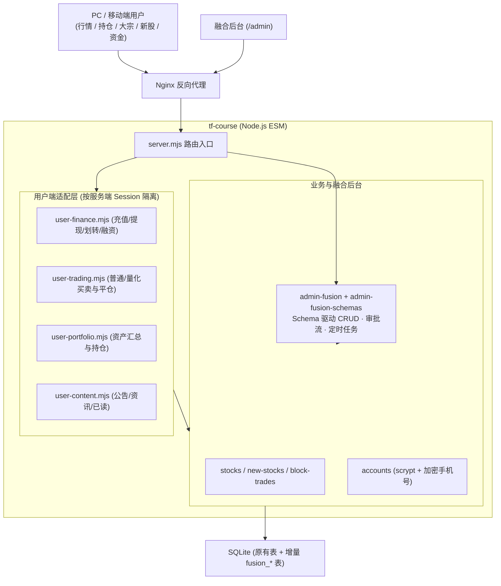

# 股票行情与模拟交易平台（`tf-course`）

> 更新日期：2026-11-23 · [返回主页](https://github.com/leee991)

一套基于 Node.js ESM + SQLite 的股票行情与模拟交易系统，包含普通买卖、量化持仓、大宗交易、新股认缴和后台运营管理。

后面要扩展新的后台功能但不想动老表，就直接在原有 `AdminWeb` 之上做了一层增量融合模块（`AdminFusion`），把新旧持仓和资金流程平滑接在了一起。

## 整体结构

## 重点做过哪些改造

1. **不动老表的增量融合后台（`AdminFusion`）**
   - 直接复用原来的数据库连接、管理员登录态、CSRF 和审计事务，只新增 `fusion_*` 表，不改旧用户表和旧大宗交易表。
   - 后台页面直接读 `/admin/api/fusion/schema/:resource` 下发的字段配置和状态动作，增删改查和审批不用每个表都手写一遍。
2. **用单号前缀把新老持仓无缝兼容**
   - 老的大宗单带 `B`/`DZ` 前缀，继续走老服务；新增的融合持仓带 `F`/`FP` 前缀，走新平仓和撤单逻辑，互不串单。
3. **防越权和资金闭环**
   - 所有用户查询和资金接口（写操作只认 `POST`）全按服务端 Session 取用户，无视前端传过来的 `userId`，跨用户查单或卖单直接 404，银行卡只回掩码。
   - 充值靠凭证和 `expectedRevision` 防重复入账；提现一提交就冻结本金和手续费，拒绝全退；平仓手续费加印花税封顶 99%，防止极端低价把余额扣成负数。
4. **配套自动化测试**
   - 写了 22 项隔离测试（16 项后端业务 + 6 项 HTTP 集成），跑完自动清临时库，不连外网行情。

## 目录说明

- `docs/ARCHITECTURE.md`：`AdminFusion` 接入方式、资金状态机和风控检查项
- `docs/API_CONTRACT.md`：融合后台接口与移动端交易/资金接口清单
- `config/`：Nginx、Systemd 和 `.env.example` 配置模板
- `skeleton/`：全部核心 `.mjs` 业务模块和 Schema 骨架
- `DIRECTORY_TREE.txt`：代码目录树统计
