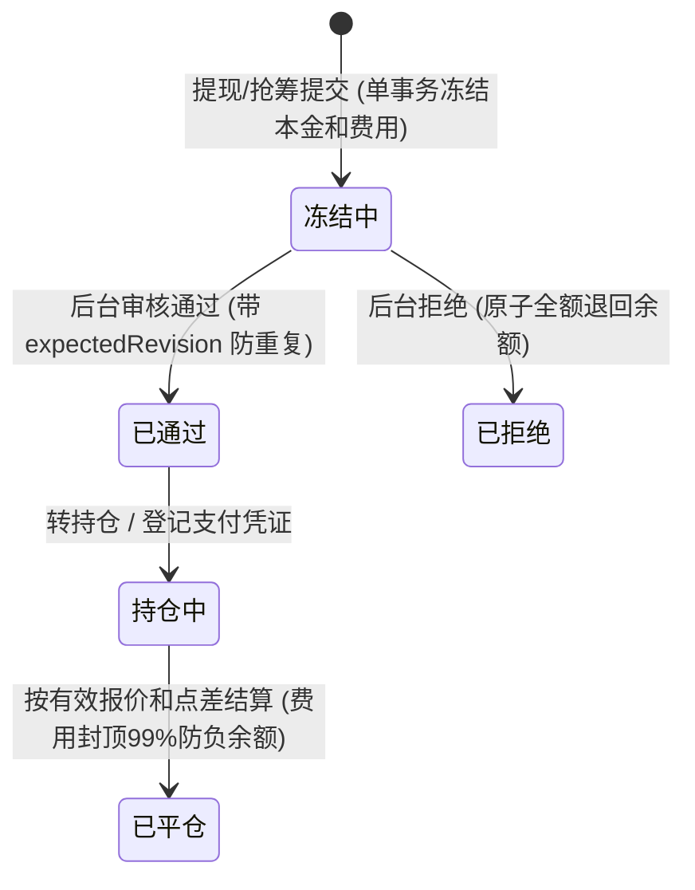

# 架构与资金流程说明 — `tf-course`

## 1. `AdminFusion` 是怎么挂到老后台上的

1. 复用原 `AdminWeb` 的数据库、管理员会话、CSRF 和事务。
2. 原后台验完登录态，先走 `fusion.authorize(admin, req, route)` 统一卡角色权限。
3. 后台请求先给 `fusion.handle(...)`，匹配到 `/admin/api/fusion/*` 就接管，没匹配返回 `undefined` 交回原路由。
4. 移动端请求先给 `fusion.publicApi(...)`，同样按需接管、其余透传。

## 2. 资金冻结与结算状态

## 3. 风控检查项
融合交易下单和提现前统一检查：交易时段/周末休市、产品和市场开关、是否已实名、单笔金额和股数范围、同股和每日频率限制、提现门槛及手续费。
